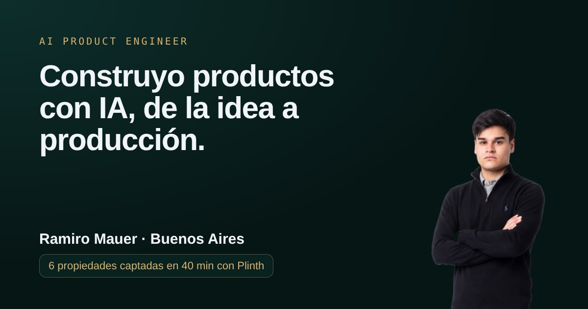

# Portfolio · Ramiro Mauer

Sitio personal de Ramiro Mauer, AI Product Engineer en Buenos Aires.
**En vivo:** https://portafolio-ramiro-mauer.vercel.app · [versión en inglés](https://portafolio-ramiro-mauer.vercel.app/?lang=en)



## Qué tiene

- **Proyectos** con capturas reales: Plinth (producto principal), Focus Quest y GeoDental.
- **Caso de estudio de Plinth** (`/#plinth`): problema, decisiones, qué se rompió y cómo se resolvió, resultado.
- **Cómo trabajo**: el método con el que construyo dirigiendo agentes de código, con evidencia de proyectos reales.
- **Notas** (`/#nota-voz`, `/#nota-fotos`): cómo resolví problemas concretos.
- **Español e inglés**, CV descargable en PDF e imagen de vista previa para compartir el link.
- **Detalles de interfaz**: menú de comandos (⌘K / Ctrl+K), grilla que se ilumina con el cursor, capturas ampliables, barra de lectura en notas y caso de estudio.

## Decisiones técnicas

- **Vite + React + TypeScript + Tailwind**, sin backend: es un sitio estático que carga rápido y se despliega solo en Vercel.
- **Contenido separado del diseño**: todos los textos viven en `src/data/data.ts` y `src/context/LanguageContext.tsx`, en los dos idiomas. Cambiar un texto no toca componentes.
- **Rutas por hash** (`#plinth`, `#nota-voz`) para tener páginas internas sin configurar el servidor.
- **Idioma** por `?lang=en`, `#en` o la última elección guardada en el navegador.

## Cómo correrlo

```bash
npm install
npm run dev      # servidor local
npm run build    # chequeo de tipos + build de producción
```

Cada push a `main` se publica automáticamente en Vercel.

## Estructura

```
src/
  data/data.ts                  textos de proyectos, caso de estudio, método y notas
  context/LanguageContext.tsx   textos de la interfaz y manejo de idioma
  components/                   secciones y páginas
public/
  shots/                        capturas de los productos
  cv/                           CV en PDF (ES y EN)
  og-es.jpg, og-en.jpg          imágenes de vista previa
```

## Licencia

MIT para el código del sitio. Las capturas, la foto y los textos son de Ramiro Mauer.
